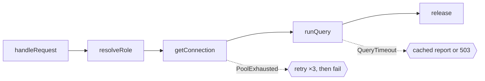
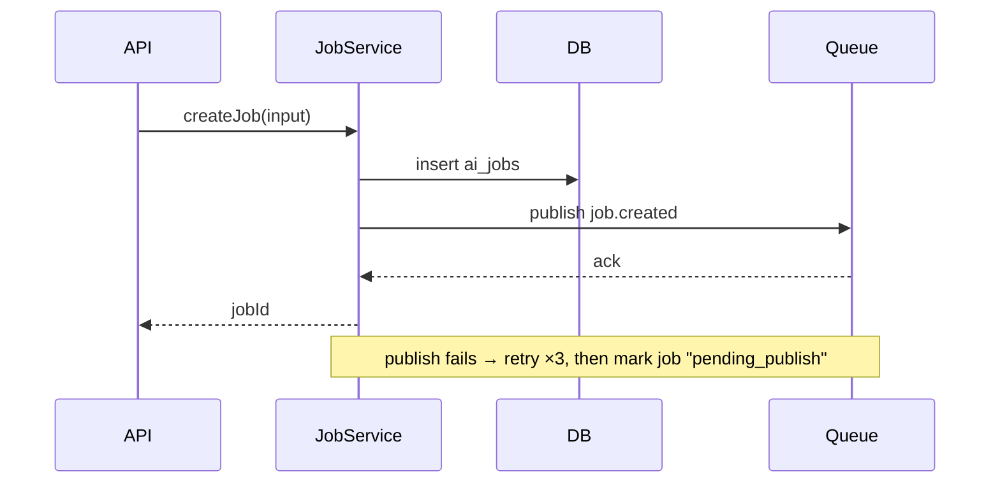

# Call Graph Planning

Every full-path RFC has a **Call Graph** in its Design section: a picture of how the change will run, drawn before any code is written. The idea comes from [Call Graph Planning](https://gist.github.com/r17x/90eb2f7be93932b5693753aedb09c01a). Code is a graph of functions, so draw the graph first, and the code follows it. If the code stops matching the graph, either the code or the graph is wrong.

This page is the writing guide. `/act-sdlc:to-spec` follows it when it drafts the design, and reviewers can use it to check the RFC in Linear. Linear renders the ` ```mermaid ` blocks as diagrams.

## Where it fits

| Artifact | What it holds |
| :- | :- |
| RFC → Requirements | **What** the system does, as seen from outside. No function names. |
| RFC → Design → **Call Graph** | **How** it runs inside: functions, data flow, failure points, dependencies. |
| RFC → Tasks | The graph's nodes turned into a checklist, leaves first, each tagged with its repository. |
| Code (Development) | Follows the graph. When the code has to differ, update the Call Graph in the Linear RFC too. |

## What to decide, in order

1. **Domain shapes.** Name the data that flows through the graph: records, IDs, variants such as `Role = app | admin`, and the domain errors such as `QueryTimeout`.
2. **Happy path.** Draw the success path first: which function calls which, and what data passes between them.
3. **Kind of each node.** Is it one-shot (returns one value), a stream (many values over time), or cached (computed once, reused)?
4. **Failure points.** For each place the graph can break, choose one:
   - **retry**: transient failures such as timeouts or rate limits;
   - **fallback**: recoverable, with a default, a cached value, or a degraded response;
   - **fail**: a bug or broken invariant. Stop and surface it; don't hide it.
5. **Needs.** What each node depends on: a database pool, a config value, another service.
6. **Boundaries.** Where untrusted input enters (HTTP requests, files, environment variables, queue messages). Validate and parse it there and nowhere else, so inner nodes can trust their inputs.
7. **Cross-cutting behavior.** Logging, retries, metrics and timeouts wrap nodes without changing the graph.
8. **Resources.** Anything acquired (connections, locks, files) is released by its scope, even on failure.
9. **Tests.** Same graph, different dependencies: tests swap what a node needs, such as an in-memory pool or a fake API, and never reshape the graph.
10. **Code shape.** In the code, the main body reads as the happy path, and failure handling sits in one place beside it rather than scattered through it.

## How to write it

Pick the format by the shape of the change:

| Change | Format |
| :- | :- |
| Flow inside one service or module | **Mermaid flowchart + node table** (the default) |
| Interaction across services or components (API → service → DB → queue) | **Mermaid sequence diagram + node table** |
| Light path (`phases.lightLabels`, `Small Size` by default) | **Numbered steps.** A diagram isn't needed |

Rules for every format:

- Keep the diagram to the happy path plus failure edges. If it grows past about 12 nodes, split it into one diagram per flow.
- Use the real function and module names you plan to write, so the graph maps one to one onto the code.
- Put annotations in the table, not in the diagram, so the diagram stays readable.
- Draw failure edges as dotted arrows labelled with the error name, ending at what happens next.
- Add a **Tests** line saying which dependencies are swapped. If production and test wiring differ in shape, draw a second diagram.

### Node table columns

| Column | Meaning |
| :- | :- |
| Node | The function or component, exactly as named in the diagram |
| Input → Output | The data shapes in and out |
| Kind | `one-shot`, `stream`, `cached`, and `boundary` where untrusted input is parsed |
| Needs | Dependencies the node requires |
| On failure | `retry …`, `fallback …`, or `fail`, plus the error name |
| Ask | Who to ask about this part. **Existing code:** the CODEOWNERS owner first, otherwise the main authors from git history, as a Linear `@mention` or a GitHub `@login`, with the date of the last change. Mark authors who haven't touched it in over 18 months `(stale)`, and add a co-author if there is one. **New nodes:** `owner of task X.Y`. Never write an email |

`scripts/who.mjs <file>:<symbol>` gives the Ask data for existing code, from CODEOWNERS and from git history narrowed to that function. Use it instead of guessing.

## Example: flowchart + table

From ACT-130's guardrails:

````markdown
## Call Graph

Domain: `Role = app | admin`; errors `PoolExhausted`, `QueryTimeout`.



| Node | Input → Output | Kind | Needs | On failure | Ask |
| :- | :- | :- | :- | :- | :- |
| handleRequest | HTTP request → response | boundary | – | 400 on invalid input | owner of task 2.1 |
| resolveRole | user → `Role` | one-shot | AuthContext | fail (bug) | owner of task 2.1 |
| getConnection | `Role` → connection | one-shot | Pool per role | retry ×3, then fail (`PoolExhausted`) | owner of task 2.2 |
| runQuery | connection, SQL → rows | one-shot | `statement_timeout` per role | fallback: cached report or 503 (`QueryTimeout`) | owner of task 2.2 |
| release | connection → – | scoped | – | always runs | owner of task 2.2 |

**Tests:** same graph; `Pool` → `InMemoryPool`, database → `FakeDb`.
````

## Context & people

Right after the Call Graph, add a `### Context & people` section, so readers know what came before and who to ask. Each line names its source and an as-of date, because this goes stale. Sources:

- **Related issues and RFCs:** keys in the PRs that last touched this code, the issue's own relations and comments, and a search for the feature's key terms. Name the decisions they record that this RFC must respect.
- **Recent PRs** on the involved code: the PR numbers in `who.mjs`'s recent commits, with their author and date from GitHub.
- **People who know the domain:** CODEOWNERS owners, the issue's reporter, and whoever made the decisions in comments.
- **Threads:** linked Slack threads and Linear discussions.

Example, for a change to IP restrictions in `archix_cms_backend`, as of 2026-10-22:

````markdown
### Context & people

Gathered 2026-10-22 from git, GitHub, and Linear.

- **Related:** ACT-164, "Investigate IP restrictions not being enforced across subscriptions" (In Progress). It traced an outage where no client IP resolved behind the proxy (`TRUST_PROXY`), and its fix PR #1023 enforces restrictions on GraphQL subscriptions.
- **Recent PRs:** #1023 "fix(ip-restriction): enforce IP restrictions on GraphQL subscriptions" (@chr-nguyen, open); #916 "Feat/enforce ip restrictions" (@chr-nguyen, 2026-08-27); #784 "fix: add try catch and transactional" (@hikruschips, 2026-07-02).
- **People:** @chr wrote 99% of `ip-restriction.service.ts` and knows the guard and the subscription path. @hikruschips added the transaction handling.
- **Threads:** the archix-csv production alert on ACT-164 (Slack), with the `IP restriction skipped for org=` log line to grep.
````

| Node | … | Ask |
| :- | :- | :- |
| ipRestrictionGuard | … | @chr (last change 2026-08-27) |
| shouldSkipUntrustedProxyIp | … | @chr (last change 2026-08-27) |

## Example: sequence diagram

For flows across services:

````markdown

````

Follow it with the same node table, one row per participant call.

## Example: light path

```markdown
## Call Graph

1. `handleRequest` parses the form (boundary).
2. `updateProfile` writes the new name. On `NotFound`: fail with 404.
3. Response returns the updated profile.
```

## Checklist for reviewers

- [ ] The happy path reads left to right, or top to bottom, without needing the table.
- [ ] Every node in the diagram has a table row, and every row is in the diagram.
- [ ] Every failure point names its error and says retry, fallback or fail.
- [ ] Untrusted input is parsed only at nodes marked `boundary`.
- [ ] The **Tests** line swaps dependencies without changing the graph.
- [ ] The task checklist covers every node, and each task names its repository.
- [ ] Every node has an Ask entry: a person for existing code, a task owner for new code, and no emails.
- [ ] Context & people lists related issues and PRs with dates, and names who knows the domain.
