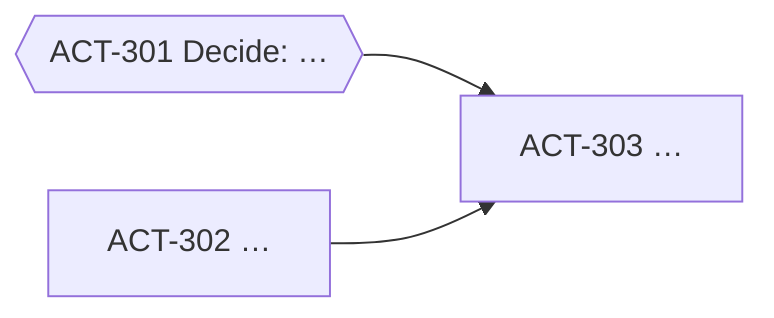

# Plan a Linear issue: triage, then split if it's too large

Arguments: `$ARGUMENTS`

This is phase 1 (Planning) in `${CLAUDE_PLUGIN_ROOT}/docs/lifecycle.md`. It comes before `/act-sdlc:to-spec`.

**What this command may write to Linear, and nothing else:**
- **On the issue itself:** add labels, append-only, through `save_issue` with `id` and `addLabels`. Never change its description, title, status, assignee, priority, or existing labels, and never comment.
- **When splitting:** create sub-issues under it, with their own labels and blocking relations, and create one `Plan: <title>` document on the parent.
- Never edit, close, or relabel issues that already exist other than the parent's added labels.

## 1. Read everything

1. Resolve the key from the argument. A URL contains it in `/issue/<KEY>/`. Uppercase it.
2. Read the issue with `get_issue` (prefix `mcp__claude_ai_Linear__` or `mcp__linear__`), with `title`, `description`, `status`, `labels`, `priority`, `team`, `project`, `parentId`, `documents`, and relations.
3. Read its comments with `list_comments`. Comments often hold the real plan, such as ACT-95's six steps.
4. Read its existing sub-issues with `list_issues` filtered by `parentId: <KEY>`, and any `Plan:` or `RFC:` document with `get_document`.
5. Read the team's labels with `list_issue_labels` for the issue's team. **Only ever add labels that already exist there.**
6. Get the settings:
   - `node "${CLAUDE_PLUGIN_ROOT}/scripts/config.mjs" get plan.autoSplit`
   - `node "${CLAUDE_PLUGIN_ROOT}/scripts/config.mjs" get phases.lightLabels`

**Already planned?** If the issue has sub-issues or a `Plan:` document, don't create anything new. Show the current map with `/act-sdlc:status <KEY>`, add any missing labels, and stop. If the user wants more tickets, list what you'd add and wait for them to say yes, so tickets are never duplicated.

## 2. Triage: give one verdict

Judge the issue on these points, and keep one line of reasoning for each:

| Check | Question |
| :- | :- |
| Problem | Is it clear why this matters and for whom? |
| Outcome | Is it clear what "done" looks like? Is there an "Acceptance criteria" section, or a part that is one in all but name, like ACT-184's "Ideal"? |
| Size | Can one RFC and one stretch of work deliver it, or does it hold several independently shippable stages? |
| Unknowns | Are there decisions or facts, such as a vendor choice, missing access, or a number Product must set, whose answer would change the design? |
| Type | Is it Feature, Bug, Improvement, or research? Does it need a design review (RFC)? |

Then choose exactly one verdict:
- **Ready:** the problem and outcome are clear, it fits one RFC, and no open decision changes the design. Next step: `/act-sdlc:to-spec <KEY>`.
- **Needs info:** the problem or outcome isn't clear enough to plan, for example there's no aim and no criteria. Splitting won't fix that; a person has to answer questions first.
- **Too large:** the outcome is clear, but it holds several shippable stages, or decisions that must be made before parts of it can be designed.

## 3. Add labels to the issue

Add, append-only, the labels that fit and exist in the team:
- one type label: `Feature`, `Bug`, `Improvement`, or `research`;
- `RFC` when the work needs a design review before coding, which a too-large issue always does;
- a light-path label from `phases.lightLabels`, such as `Small Size`, only when the verdict is Ready and the change is small.

Use `save_issue` with `id: "<KEY>"` and `addLabels: [...]`. Skip labels the issue already has.

## 4. Split, when the verdict is Too large

Skip this step if the user passed `--no-split` or `plan.autoSplit` is `false`. In that case, show the proposed map from step 4.1 in chat and stop.

Otherwise split without asking. The team chose this.

### 4.1 Design the map

Use two kinds of tickets:
- **Decision tickets:** one question whose answer changes the design or scope, such as "Which risk-signal vendor?" or "Which false-positive rate is acceptable?". Title them `Decide: <question>`. Their description holds a **Who decides or knows** line, built from the people who argued options in the comments, the reporter, and, when the area's code is in a local repo, `node "${CLAUDE_PLUGIN_ROOT}/scripts/who.mjs" <file>[:<symbol>]` for its main authors (names or @mentions, never emails). It also holds:
  - the context, linking the parent;
  - the options already on the table, from the issue and comments;
  - the evidence that would settle it, for example a prototype, data, or a person who decides.
  - Acceptance criteria: *the decision and its reasoning are recorded in this issue's RFC.*
- **Work tickets:** vertical slices that can each be shipped and verified alone, in delivery order. Their description holds:
  - the context, linking the parent;
  - the scope;
  - the repositories involved;
  - an `## Acceptance criteria` section with testable items, so `/act-sdlc:to-spec` and `/act-sdlc:status` work on it directly.

Rules for the map:
- **Blocking edges:** a decision blocks the work that depends on its answer, and a slice blocks the slices built on it. There are no cycles.
- **Size:** 3 to 8 tickets. If a ticket still looks too large, make the first stages concrete. Add one work ticket per later stage, titled `Plan stage N: …`, to be planned again with `/act-sdlc:plan` when its turn comes.
- **Source:** keep what the issue and comments already decided, for example ACT-95's "use Postgres, not Redis", and cite where it came from. Don't reopen settled decisions as decision tickets.
- **Out of scope:** anything the issue says is optional or conditional, such as ACT-95 step 6 "only if abuse continues", becomes the last ticket, blocked by the ticket whose result decides it.

### 4.2 Create the sub-issues

Create them in blocking order, so every blocker exists before the tickets it blocks. Use `save_issue` with:
- `team`: the parent's team;
- `parentId: "<KEY>"`;
- `title` and `description` (unescaped Markdown);
- `priority`: the parent's;
- `labels`: `RFC` (plus `research` for investigations) on decision tickets, and the type label (plus `Small Size` if small) on work tickets, all from the team's existing labels;
- `blockedBy`: the keys of the tickets that block it.

Don't set an assignee, status, cycle, or estimate; people decide those.

If a create fails partway, stop. Report the tickets already created, and don't retry blindly, which would create duplicates.

### 4.3 Create the Plan document on the parent

Create it with `save_document`, passing `issue: "<KEY>"`, `title: "Plan: <issue title>"`, and this content:

````markdown
## Verdict

Too large, because <one or two sentences>. Triage notes:
- **Problem:** …
- **Outcome:** …
- **Size:** …
- **Unknowns:** …

## Map



Decision tickets use `{{…}}` nodes; work tickets use `[…]`. Arrows point from the blocker to what it unblocks.

| Ticket | Kind | Title | Blocked by | Labels |
| :- | :- | :- | :- | :- |
| ACT-301 | Decision | Decide: … | – | RFC |

## How to proceed

Pick the first ticket with no open blockers. Run `/act-sdlc:to-spec <ticket>` for work tickets. Decision tickets get an RFC that records the decision. `/act-sdlc:status <KEY>` shows progress across all of them.

## Open questions

Questions for people that no ticket answers yet, if any.
````

## 5. Report

- The verdict, with the triage notes as one line each.
- The labels added, or "none needed".
- **Ready:** next, `/act-sdlc:to-spec <KEY>`.
- **Needs info:** the specific questions to ask in Linear, and who should answer them if that's clear. Don't post them; this command never comments.
- **Too large:**
  - the created sub-issues as a short list, with key, kind, title, and blocked-by;
  - the Plan document link;
  - the first ticket to pick up;
  - `/act-sdlc:status <KEY>`, which now shows progress across the sub-issues.
